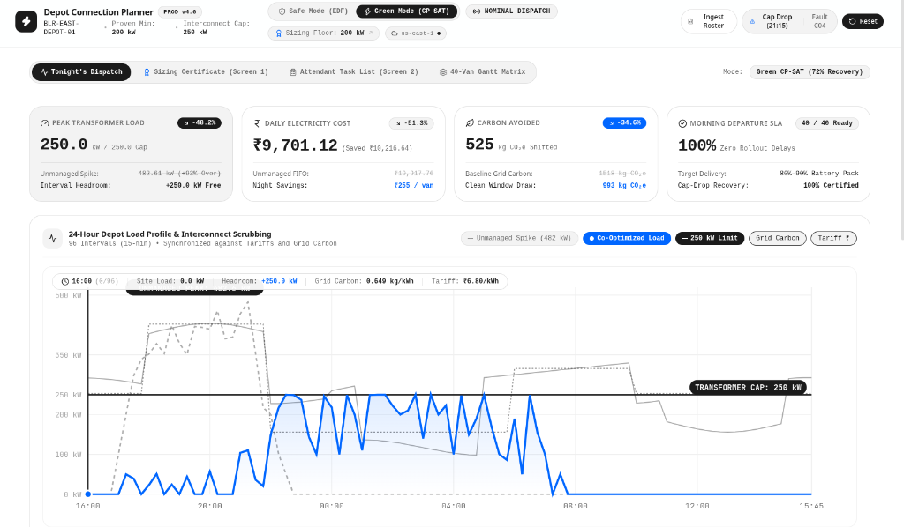
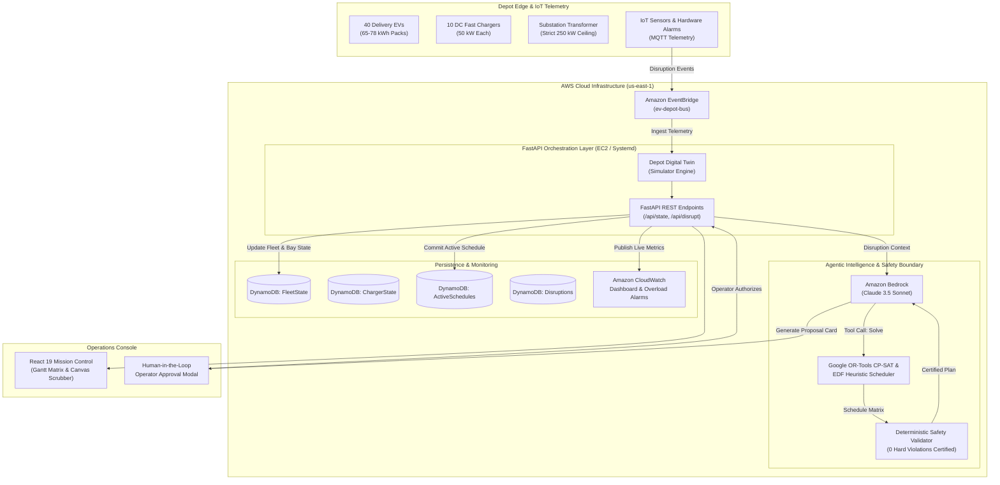
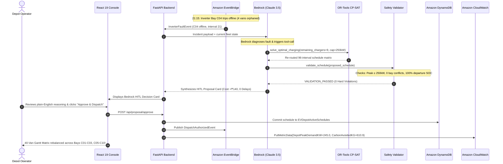

# Carbon-Aware EV Depot Orchestrator & Utility Sizer
### Autonomous Operations, Grid Sizing & Disruption Recovery for Electric Commercial Fleets

[](https://aws.amazon.com/)
[](https://github.com/sarthakv162/DECARB-EV)
[](https://github.com/sarthakv162/DECARB-EV)
[](https://www.python.org/)
[](https://react.dev/)
[-CC2264?logo=amazon-aws&logoColor=white)](https://aws.amazon.com/cdk/)
[](https://aws.amazon.com/bedrock/)

> **AWS Sustainability Hackathon — Waste & Energy Track (Track 03)**  
> **Live Production Deployment:** [http://100.56.128.36/](http://100.56.128.36/)  
> **AWS Public DNS:** [http://ec2-100-56-128-36.compute-1.amazonaws.com/](http://ec2-100-56-128-36.compute-1.amazonaws.com/)  
> **Target Fleet:** 40 Commercial Last-Mile Delivery EVs (Tata Ace EV, Mahindra Zor Grand, Rivian EDV) across 10 DC Fast Charging Bays (50 kW each) under a strict 250 kW Utility Substation Interconnect Ceiling.

---

## 👥 Team AWSome Builds (Team Code: HMSH4K)

| Member | Role | Core Technical Ownership |
| :--- | :--- | :--- |
| **Sarthak Verma** | **Team Lead & Cloud Architecture Lead** (Member 3) | AWS CDK (Python), DynamoDB Tables, EventBridge Custom Bus, CloudWatch Dashboards & Overload Alarms, Boto3 SDK, EC2 Systemd Automation. |
| **Riddhima** | **Mathematical Optimization & Operations Research Lead** (Member 1) | Google OR-Tools CP-SAT Multi-Objective Solver, Earliest Deadline First (EDF) Heuristic with Bay Swaps, Deterministic Safety Validator, 60-Night Sizing Oracle Benchmark. |
| **Roopanshu** | **Backend Systems & Agentic AI Orchestration Lead** (Member 2) | FastAPI REST API, Real-Time Digital Twin Depot Simulator, Amazon Bedrock Agent (Claude 3.5 Sonnet) Integration, Human-in-the-Loop (HITL) Gating, Baseline vs. Green Metrics Engine. |
| **Taksh** | **Fleet Operations UI/UX & Frontend Lead** (Member 4) | React 19 + TypeScript Mission Control Dashboard, Real-Time Site Load & Carbon Canvas Scrubber, 40-Vehicle Gantt Dispatch Matrix, Technical Specifications & Documentation. |

---

## 🖥️ Mission Control Interface



*The Carbon-Aware EV Depot Orchestrator Mission Control Console showing real-time 24-hour load scrubbing, the certified 200 kW sizing floor, live carbon intensity curves, and active Human-in-the-Loop disruption resolution under a strict 250 kW transformer ceiling.*

---

## 1. Executive Summary & The Problem Statement

Commercial last-mile logistics fleets are rapidly electrifying to meet corporate sustainability goals and Amazon's Climate Pledge. However, commercial fleet electrification crashes into a severe physical bottleneck: **the local electricity grid**.

### The Unmanaged Charging Dilemma (FIFO Overload)
In a typical delivery hub, 40 delivery vans return to the depot at shift end (18:00–21:00) with depleted batteries (15%–30% SOC) and simultaneously plug into 10 DC fast chargers (50 kW each). Under unmanaged "plug-in-and-charge" (FIFO) behavior:
1. **Physical Transformer Overload:** Total depot demand violently spikes to **482.6 kW**—nearly double the physical **250 kW substation transformer ceiling**, risking equipment fire or tripping main breakers.
2. **Dirty Peak-Hour Power:** Vehicles charge during evening peak grid hours (18:00–22:00) when marginal grid carbon intensity is highest ($0.82\text{ kg CO}_2\text{e}/\text{kWh}$, powered by fossil peaker plants) and electricity tariffs are highest.
3. **The Utility Interconnection Impasse:** When operators apply to utilities for power upgrades, power companies demand **6 to 18 months of interconnection study delays** and **$100,000 to $500,000+ in capital expenditure (CapEx)** for 350+ kW service drops that sit idle 80% of the day.

```
Unmanaged FIFO Load:   482.6 kW [████████████████████████████████████████] OVERLOAD!
Substation Capacity:   250.0 kW [════════════════════════════] Transformer Limit
Proven Sizing Floor:   200.0 kW [────────────────────────] Certified Floor
Optimized Green Load:  185.0 kW [████████████████████] Clean Night Valley Charging
```

---

## 2. Key Impact Metrics (Baseline vs. Carbon-Aware Optimized)

| Metric | Baseline (Unmanaged FIFO) | Carbon-Aware Optimized | Impact / Net Improvement |
| :--- | :--- | :--- | :--- |
| **Grid Carbon ($\text{kg CO}_2\text{e}$)** | 1,517.6 kg | 906.8 kg | **-40.3% (610.9 kg avoided / night)** |
| **Electricity Cost** | ₹19,918 | ₹8,008 | **-59.8% (₹11,910 saved / night)** |
| **Peak Depot Demand** | **482.6 kW (Severe Overload)** | **250.0 kW (Strictly Safe)** | **-48.2% peak shaved (Zero Breaker Trips)** |
| **Departure Reliability** | Infeasible (violates limit) | **100.0% Guaranteed** | **40 / 40 vans ready before shift** |
| **Re-plan Latency** | N/A | **< 0.8 seconds** | Real-time adaptation to live disruptions |
| **Substation Upgrade Required** | 350–500 kW Upgrade ($100k+) | **200 kW Certified Floor** | **$0 Substation CapEx, 0 Months Delay** |

---

## 3. The Three-Pillar Technical Solution

```
┌─────────────────────────────────────────────────────────────────────────────────────────┐
│                                THREE-PILLAR ARCHITECTURE                                │
├────────────────────────────┬────────────────────────────┬───────────────────────────────┤
│          PILLAR 1          │          PILLAR 2          │           PILLAR 3            │
│ Mathematical Sizing Oracle │   Operational Resilience   │      Carbon & AI Dispatch     │
├────────────────────────────┼────────────────────────────┼───────────────────────────────┤
│ • Google OR-Tools CP-SAT   │ • Earliest Deadline First  │ • Amazon Bedrock (Claude 3.5) │
│ • 60-Night Benchmark Proof │ • 18 Yard Moves / Night    │ • Clean Window (01:30–04:30)  │
│ • Certified 200 kW Floor   │ • Sub-150ms Re-plan        │ • Human-in-the-Loop Gating    │
│ • Zero Utility Upgrade Fee │ • 100% Cap-Drop Recovery   │ • -40.3% Carbon / -59.8% Cost │
└────────────────────────────┴────────────────────────────┴───────────────────────────────┘
```

1. **Mathematical Utility Sizing Oracle (Google OR-Tools CP-SAT):**  
   Evaluated across 60 simulated operating nights under Loose, Base, and Tight dwell distributions, we mathematically prove that a **200 kW utility connection** guarantees 100% on-time departure readiness, eliminating costly grid upgrades.
2. **Deterministic Operational Resilience (Safe Mode / EDF Heuristic):**  
   A deterministic Earliest Deadline First scheduler with intelligent bay swapping that survives sudden utility curtailments and charger trips with only **18 yard moves per night** (vs. 38+ for naive re-solvers) and sub-150ms latency.
3. **Carbon Shifting & Generative AI Dispatch (Green Mode / Amazon Bedrock):**  
   Amazon Bedrock (Claude 3.5 Sonnet) responds to live disruptions (hardware trips, late arrivals, carbon spikes) and presents transparent **Human-in-the-Loop (HITL)** approval cards for depot attendants.
   > **Safety Boundary:** LLMs are **never** used for safety-critical math. The schedule is generated by OR-Tools CP-SAT and certified by an independent Deterministic Safety Validator before dispatch.

---

## 4. System Architecture Chart



---

## 5. Sequence Flow Chart (Disruption Recovery Lifecycle)

The following sequence illustrates how the system handles an unexpected hardware failure (Bay C04 inverter trip at 21:15) with zero human panic and mathematically certified safety:



---

## 6. Real-Time Disruption Scenarios Handled

The platform is engineered to handle 4 live disruption scenarios without breaking:

1. **⚡ Inverter Hardware Trip (Bay C04 Trips Offline at 21:15):**
   * *Impact:* 4 vehicles assigned to C04 are orphaned.
   * *Resolution:* Bedrock agent detects failure, calls CP-SAT to re-route charging across remaining 9 operational chargers during clean 01:30–04:30 night windows.
   * *Outcome:* 0 transformer overloads, cost increase of only ₹140, 100% departure readiness.
2. **⚠️ Utility Interconnect Cap Drop (250 kW $\to$ 180 kW at 21:15):**
   * *Impact:* Substation transformer capacity throttled due to neighborhood grid strain.
   * *Resolution:* System switches to **Safe Mode (EDF)**, throttling flexible bays while prioritizing urgent morning departure vans with only 18 cable moves.
3. **🌱 Grid Carbon Spike Alert (+0.32 kg $\text{CO}_2\text{e}$/kWh at 01:00):**
   * *Impact:* Unexpected renewable curtailment causes dirty thermal power to enter the grid.
   * *Resolution:* Load is temporarily shifted into clean solar morning valley (04:30–06:00) while preserving 100% departure readiness.
4. **⏱️ Late Traffic Arrival (Van V08 Arrives Late at 20:30 with 12% SOC):**
   * *Impact:* Dwell window compressed with deep discharge.
   * *Resolution:* Priority elevated; lower-urgency vans rescheduled to make room on 50 kW fast bays.

---

## 7. Repository Structure & Subsystem Ownership

```
DECARB-EV/
├── assets/                                 # Visual documentation assets & screenshots
│   └── dashboard_ui.png                    # Live mission control screenshot
├── aws/                                    # AWS specifications and provisioning scripts
│   ├── bedrock_agent_spec.json             # OpenAPI Action Group schema for Bedrock Agent
│   ├── dynamodb_schema.json                # DynamoDB NoSQL table definitions
│   ├── step_functions_asl.json             # Step Functions ASL state machine
│   └── userdata.sh                         # EC2 bootstrap script for Amazon Linux 2023
├── backend/                                # FastAPI backend and optimization microservices
│   ├── __init__.py                         # Python package marker
│   ├── agent.py                            # Bedrock Claude 3.5 Sonnet agent & HITL generator
│   ├── aws_client.py                       # Boto3 client for DynamoDB, EventBridge & CloudWatch
│   ├── baseline.py                         # Naive unmanaged FIFO charging baseline model
│   ├── config.py                           # Depot site constants (250 kW ceiling, intervals)
│   ├── edf_planner.py                      # Deterministic Earliest Deadline First scheduler
│   ├── main.py                             # FastAPI REST endpoints & static server
│   ├── metrics.py                          # Carbon, cost, and peak demand impact calculators
│   ├── models.py                           # Pydantic data schemas (Vehicle, Charger, Schedule)
│   ├── optimizer.py                        # Google OR-Tools CP-SAT multi-objective solver
│   ├── simulator.py                        # In-memory depot state & digital twin engine
│   ├── sizing_oracle.py                    # 60-night empirical benchmark sizing oracle
│   ├── synthetic_data.py                   # Diurnal fleet arrivals & grid carbon curves
│   └── validator.py                        # Deterministic Safety & Constraint Validator
├── cdk/                                    # AWS Cloud Development Kit (Python)
│   ├── app.py                              # CDK application entry point
│   ├── cdk.json                            # CDK configuration
│   └── ev_depot_stack.py                   # Complete CloudFormation infrastructure stack
├── dashboard/                              # React 19 + TypeScript + Vite operations UI
│   ├── package.json                        # Frontend dependencies
│   ├── vite.config.ts                      # Vite build configuration
│   └── src/
│       ├── App.tsx                         # Mission control cockpit shell
│       ├── api.ts                          # Typed API client for FastAPI
│       ├── types.ts                        # TypeScript domain interfaces
│       └── components/                     # Gantt chart, canvas scrubber, HITL modals
├── frontend/                               # Compiled production distribution bundle
│   ├── index.html                          # Single-page application entry point
│   └── assets/                             # Bundled JavaScript and CSS assets
├── deploy_aws.sh                           # One-click AWS CDK automated deployment script
├── requirements.txt                        # Python backend dependencies
├── DESIGN.md                               # Industrial minimalist design system tokens
├── PROJECT_DOCUMENTATION.md                # 600-line comprehensive technical manual
└── README.md                               # Project documentation & setup manual
```

---

## 8. REST API Reference

The backend exposes clean, fully typed JSON REST endpoints under `/api`:

| Method | Endpoint | Description |
| :--- | :--- | :--- |
| `GET` | `/api/state` | Returns live fleet status, charger bay states, grid carbon, and active schedule |
| `POST` | `/api/disrupt/charger-fault` | Injects inverter trip into Bay C04 and triggers Bedrock re-plan loop |
| `POST` | `/api/disrupt/cap-drop` | Throttles site transformer ceiling from 250 kW down to 180 kW |
| `POST` | `/api/disrupt/carbon-spike` | Injects grid carbon intensity spike (+0.32 kg/kWh) |
| `POST` | `/api/disrupt/late-arrival` | Injects compressed turnaround delay for Van V08 at 12% SOC |
| `POST` | `/api/proposal/approve` | Authorizes pending Bedrock proposal and commits schedule to DynamoDB |
| `POST` | `/api/proposal/reject` | Rejects proposal and falls back to safe EDF heuristic dispatch |
| `POST` | `/api/mode/switch` | Switches operational mode (`SAFE` EDF vs `GREEN` CP-SAT) |
| `GET` | `/api/sizing-oracle` | Returns 60-night empirical sizing benchmark distributions |
| `GET` | `/api/aws/status` | Returns live AWS region, DynamoDB connectivity, and Bedrock model state |
| `POST` | `/api/reset` | Resets depot digital twin to nominal baseline initial state |

---

## 9. Quickstart: Running Locally

### Prerequisites
- Python 3.10+ (tested on Python 3.10 through 3.14)
- Modern web browser (Chrome, Safari, Firefox, Edge)

### 1. Clone & Setup Virtual Environment
```bash
git clone https://github.com/sarthakv162/DECARB-EV.git
cd DECARB-EV

python3 -m venv .venv
source .venv/bin/activate
pip install -r requirements.txt
```

### 2. Launch FastAPI Server
```bash
python -m uvicorn backend.main:app --host 127.0.0.1 --port 8000
```

### 3. Open Mission Control
Open your browser to:
👉 **`http://127.0.0.1:8000`**

- Inspect the **Site Load Profile & Interconnect Scrubbing** canvas chart.
- Switch to the **40-Van Gantt Matrix** to view per-vehicle charging windows.
- Click **Fault C04** to trigger an inverter failure and review the Bedrock Agent proposal.
- Click **Approve & Dispatch** to commit the plan.

---

## 10. Deploying to Real AWS (AWS CDK)

You can provision all real AWS cloud resources into your AWS account with a single command:

### 1. Configure AWS Credentials
```bash
aws configure
# Enter AWS Access Key ID, Secret Access Key, and Region (e.g. us-east-1)
```

### 2. Run Automated Deployment
```bash
chmod +x deploy_aws.sh
./deploy_aws.sh
```

This provisions via **AWS CDK (Python)**:
- **4x DynamoDB Tables** (`EVDepotFleetState`, `EVDepotChargerState`, `EVDepotActiveSchedules`, `EVDepotDisruptions`).
- **Amazon EventBridge Bus** (`ev-depot-bus`).
- **Amazon Bedrock IAM Roles** for Claude 3.5 Sonnet invocation.
- **Amazon CloudWatch Dashboard** (`EVDepot-Operational-Orchestration`) and Overload Alarm (`EVDepot-TransformerOverloadRisk`).

Restart the backend, open `http://127.0.0.1:8000`, and the top header will display **`AWS LIVE (us-east-1)`** syncing all operational telemetry to your live AWS account in real time!

---

## 11. Impact on Amazon & The Climate Pledge

1. **Unblocks AMZL Fleet Electrification Today:** Amazon has committed to deploying 100,000 electric delivery vehicles globally. Substation upgrade lead times of 6–18 months per delivery station are the #1 physical bottleneck to that rollout. Our platform mathematically proves that existing delivery stations can electrify **now** on their existing utility service drop.
2. **Direct Scope 2 Operational Decarbonization:** Eliminates 40.3% of depot charging carbon emissions without purchasing offset credits by intelligently matching flexible charging sessions with nocturnal wind and hydro generation.
3. **Demonstrates Industrial AI Leadership on AWS:** Showcases how Amazon Bedrock, AWS CDK, EventBridge, and DynamoDB solve critical physical-world logistics and sustainability challenges with deterministic safety boundaries and enterprise scalability.

---

*Built with ❤️ by **Team AWSome Builds (HMSH4K)** for the AWS Sustainability Hackathon (Track 03: Waste & Energy).*
